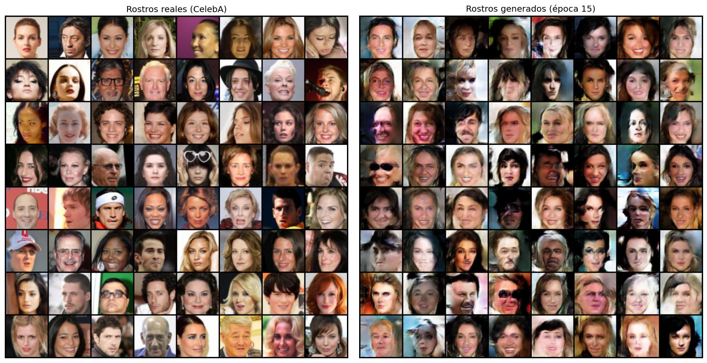
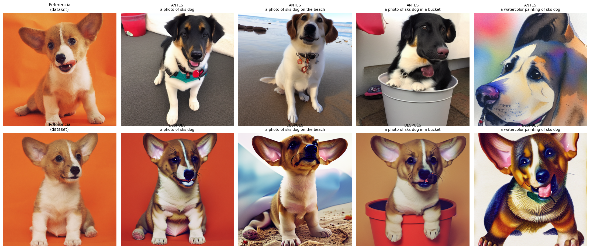

# Redes generativas: DCGAN y fine-tuning de Stable Diffusion con LoRA

Repositorio de la actividad **R2-A5-S14 Generación** de la asignatura *Deep Learning – Conceptos* (604013), Especialización en Inteligencia Artificial, Universidad de Cundinamarca.

Aquí están los dos notebooks que desarrollé y ejecuté en Google Colab (GPU Tesla T4) para trabajar con las dos grandes familias de modelos generativos de imágenes:

| Notebook | Contenido | Abrir en Colab |
|---|---|---|
| `01_dcgan_rostros.ipynb` | Primero, una GAN mínima hecha a mano con NumPy (el ejemplo de caras de 2×2 píxeles visto en clase). Después, una **DCGAN** en PyTorch entrenada con 40.000 rostros de CelebA. Incluye curvas de entrenamiento, la evolución de las imágenes, una interpolación en el espacio latente y pruebas de memorización y de colapso de modo. | [](https://colab.research.google.com/github/Juanpatula2361/deep-learning-redes-generativas/blob/main/notebooks/01_dcgan_rostros.ipynb) |
| `02_stable_diffusion_lora.ipynb` | **Fine-tuning de Stable Diffusion v1.5** con `diffusers` y **LoRA**, en modo DreamBooth, a partir de 5 fotos de un perro. Incluye el espacio latente del VAE, los procesos directo e inverso de difusión, la comparación antes/después, el análisis de *language drift* y el efecto de la escala de guía. | [](https://colab.research.google.com/github/Juanpatula2361/deep-learning-redes-generativas/blob/main/notebooks/02_stable_diffusion_lora.ipynb) |

## Resultados principales

**DCGAN (15 épocas, 13 min en T4)**
- La pérdida del generador bajó de 6,79 a 2,63, y D(G(z)) subió de 0,15 a 0,22.
- Los rostros son reconocibles desde la época 5.
- No hubo memorización ni colapso de modo: la diversidad de las caras generadas es el 101 % de la de las reales.

**Stable Diffusion + LoRA (400 pasos, 4,1 min en T4)**
- Solo se entrenó el 0,19 % de los parámetros de la U-Net (1,59 M), y el adaptador pesa 3,2 MB.
- El modelo aprendió el sujeto `sks dog` y lo ubica en contextos nuevos: la playa, un balde y una acuarela.
- Se observó *language drift*: con LoRA activo, "a photo of a dog" genera siempre el mismo cachorro.




## Estructura

```
├── notebooks/
│   ├── 01_dcgan_rostros.ipynb          # ejecutado, con todas las salidas
│   └── 02_stable_diffusion_lora.ipynb  # ejecutado, con todas las salidas
├── figuras/                            # gráficas e imágenes generadas
├── requirements.txt
└── README.md
```

## Cómo ejecutarlo

1. Abre cualquiera de los notebooks con el botón de la tabla.
2. Selecciona **Entorno de ejecución → Cambiar tipo de entorno de ejecución → GPU T4**.
3. Ejecuta todo con **Entorno de ejecución → Ejecutar todas**.

Los datos (CelebA y `diffusers/dog-example`) y el modelo (`stable-diffusion-v1-5/stable-diffusion-v1-5`) se descargan automáticamente desde Hugging Face.

## Referencias

- Goodfellow, I. et al. (2014). *Generative Adversarial Nets*. NeurIPS.
- Radford, A., Metz, L., & Chintala, S. (2015). *Unsupervised Representation Learning with Deep Convolutional Generative Adversarial Networks*. arXiv:1511.06434.
- Rombach, R. et al. (2022). *High-Resolution Image Synthesis with Latent Diffusion Models*. CVPR.
- Ruiz, N. et al. (2023). *DreamBooth: Fine Tuning Text-to-Image Diffusion Models for Subject-Driven Generation*. CVPR.
- Hu, E. et al. (2021). *LoRA: Low-Rank Adaptation of Large Language Models*. arXiv:2106.09685.
